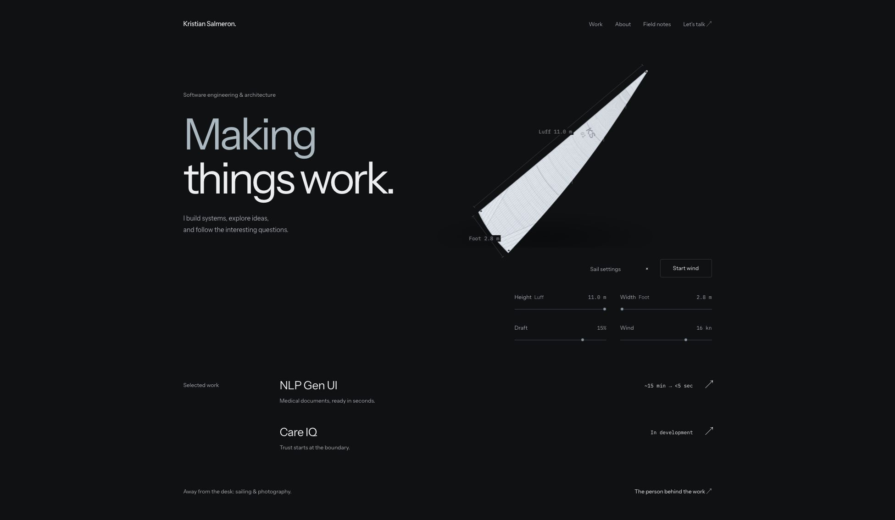

# Kristian Salmeron — Portfolio

Engineering work, architecture case studies, and interactive frontend studies by Kristian Salmeron.

**[Explore the live portfolio](https://kristiansalmeron.com/)**

The site brings together professional work, independent projects, engineering essays, and personal interests. It pairs readable, statically generated pages with focused React interactions that explain a system or invite closer inspection.



_Live portfolio · November 8, 2026_

## What to explore

- **Selected work:** a document-rendering performance case study, the CareIQ healthcare application architecture, and the portfolio itself.
- **Interactive explanations:** request stages and architecture tradeoffs alongside the written case studies.
- **Sail study:** direct controls for height, width, draft, and wind. This is an illustrative form study, not an engineering validation or sailing prediction tool.
- **Field notes and About:** two complete essays and a land, sea, and photography selector.

The interface uses responsive navigation, native controls, local fonts, and per-page metadata. Wind motion starts on request, pauses offscreen or in a hidden tab, and respects reduced-motion preferences. A static sail and readable architecture summaries remain available without JavaScript.

## Architecture

| Workspace             | Responsibility                                                                                                       |
| --------------------- | -------------------------------------------------------------------------------------------------------------------- |
| `apps/web/`           | Next.js App Router and React frontend, exported as static HTML and assets                                            |
| `apps/api/`           | Independently deployed Express API, public project summaries, first-party analytics, and the private owner dashboard |
| `packages/contracts/` | Shared API types and project-summary contracts                                                                       |
| `docs/`               | Architecture decisions, operations, content provenance, design history, and validation records                       |
| `scripts/`            | Static-export packaging and release checks                                                                           |

Public content is generated at build time and remains readable when the API is unavailable. Client components add interaction; optional first-party analytics uses the separate API and PostgreSQL store. Private reports require an owner session. See [Studio Insights](docs/ANALYTICS.md) for its configuration and privacy boundaries.

The root build assembles the deployable static frontend in `out/`. The API compiles to `apps/api/dist/` and runs as a separate Node.js service. [ADR 001](docs/decisions/001-static-ui-separate-api.md) records the original static-frontend/separate-API decision; the later analytics addition is documented separately.

## Run locally

Use **Node.js 22.23.2**, pinned in [`.node-version`](.node-version), and **pnpm 11.22.0**, pinned in [`package.json`](package.json).

```sh
git clone https://github.com/kriscodes/portfolio.git
cd portfolio
pnpm install --frozen-lockfile
pnpm --filter @kristian/contracts build
pnpm dev
```

Open the frontend at [http://127.0.0.1:3210](http://127.0.0.1:3210). The development API runs at [http://localhost:3211](http://localhost:3211), with public endpoints at `/api/v1/health` and `/api/v1/projects`.

Building the shared contracts first makes their generated exports available before the parallel development processes start. Basic portfolio browsing and the public API can run in development without a database or analytics credentials.

For local analytics work, use the variable names in [`.env.example`](.env.example) and the [analytics guide](docs/ANALYTICS.md). Load API values into the process environment before starting the API; its development script does not load a root `.env` file. Set the frontend's `NEXT_PUBLIC_ANALYTICS_ORIGIN` to the local collector before starting or building the frontend.

On systems with restrictive file-watcher limits, enable Watchpack polling in the environment before running `pnpm dev`; a POSIX-shell example is `WATCHPACK_POLLING=true pnpm dev`.

## Validate changes

```sh
pnpm validate
pnpm format:check
```

`pnpm validate` runs workspace type checks, unit and API tests, the production build, and the static-export audit. Coverage includes API contracts and analytics behavior, retained studio regressions, sail geometry, and release-audit regressions. The export audit checks content routes, internal links, local assets, accessible controls, and canonical metadata.

Set `ANALYTICS_TEST_DATABASE_URL` to a disposable PostgreSQL database to include persistent-store integration checks. Validation records and their scope are in [docs/VALIDATION.md](docs/VALIDATION.md); recorded browser checks are not a formal accessibility certification or a measured Core Web Vitals score.

Individual commands are available when working on a specific area:

| Command             | Purpose                                                          |
| ------------------- | ---------------------------------------------------------------- |
| `pnpm typecheck`    | Build shared contracts and check workspace types                 |
| `pnpm test:unit`    | Run API, analytics, frontend, sail, and audit regression tests   |
| `pnpm build`        | Build the workspaces and assemble the static export              |
| `pnpm test:web`     | Audit the generated export after a build                         |
| `pnpm format:check` | Check source and documentation formatting without changing files |

After deploying, verify delivered pages, assets, crawler files, and the custom HTTP 404:

```sh
node scripts/test-live-web.mjs https://kristiansalmeron.com
```

The HTTP check also accepts a local or staging origin.

## Documentation

- [Current analytics, owner setup, attribution links, and operations](docs/ANALYTICS.md)
- [Render deployment guide](docs/DEPLOYMENT-RENDER.md) and [Blueprint](render.yaml)
- [Development notes and preserved implementation details](docs/development-notes.md)
- [Architecture background](docs/ARCHITECTURE.md) and [static frontend/API decision](docs/decisions/001-static-ui-separate-api.md)
- [Validation history and coverage limits](docs/VALIDATION.md)
- [Content provenance and claim boundaries](docs/CONTENT-PROVENANCE.md)
- [Earlier design and content strategy](docs/DESIGN-AND-CONTENT.md), [UX review](docs/UX-REVIEW.md), and [Corner Studio design](docs/CORNER-STUDIO.md)

Some design and deployment documents preserve earlier editions. Use the current source and analytics guide for present runtime configuration, and the development notes for the design timeline.
