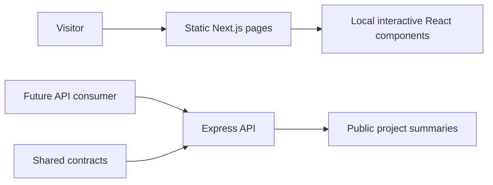

# Architecture

The interactive homepage is documented in [Corner Studio](CORNER-STUDIO.md). It adds a client-side Three.js / React Three Fiber / Drei scene to the static frontend. The existing reading routes, shared API contracts, and independent API service continue to use the boundaries below.

## CareIQ continuity

This workspace mirrors the inspected CareIQ conventions: plain pnpm workspaces, `apps/web`, `apps/api`, shared `packages`, and `docs/decisions`. It does not introduce Turborepo. The API owns future persistence and migrations; shared packages never import applications.

| Layer                      | Version          | State                              |
| -------------------------- | ---------------- | ---------------------------------- |
| Next.js / React            | 16.3.3 / 19.2.8  | Implemented App Router frontend    |
| Tailwind / PostCSS adapter | 4.3.3            | Installed; theme and bespoke CSS   |
| Web TypeScript             | 5.9.3            | Strict checks                      |
| Express                    | 5.2.1            | Working public read API            |
| API TypeScript / tsx       | 7.0.2 / 4.23.12  | Build and development              |
| Drizzle / drizzle-kit      | 0.45.2 / 0.31.10 | Reserved for the persistence slice |
| PostgreSQL client          | 8.23.0           | Installed; not connected           |
| pnpm                       | 11.22.0          | Workspace and lockfile             |

Clerk is part of CareIQ, but a public reading experience has no authentication use case. Add it only if an authenticated editing workflow is actually implemented.

## Runtime boundaries



The frontend is statically exported. It does not call the API for content required to read the portfolio. The private Sites preview hosts only the exported frontend. The Express API is a runnable foundation in the monorepo and requires a separate Node host for deployment. Nothing in the private preview implies that the API or a database has been deployed.

## Routes

The frontend uses explicit App Router pages, plus generated static params for the two notes. Each route supplies title and description metadata. A custom 404 handles unknown pages. Images live in `apps/web/public/images` and ship with the export. There are no remote font requests or runtime image-provider dependencies.

Interactive reading-page islands live in `src/components/field-tools.tsx`: request-path state, native disclosure controls, interest selection, native dialog, and clipboard feedback. Navigation is a small client component. Reading-page copy remains server-rendered. The current homepage lives in `src/components/studio/`, with its own navigation and footer in place of the reading-page chrome.

`src/components/wind-study.tsx` owns the Wind Study. React holds accessible control state; the Canvas loop holds particle positions and interpolated values in its effect, keeping frame updates out of React renders. The vector field is deterministic in its seeded distribution and expressive rather than scientifically calibrated. Device-pixel scaling is capped at 2 and particle count at 850. ResizeObserver rebuilds the surface, IntersectionObserver and document visibility suspend animation, and cleanup disconnects observers and cancels animation frames. Pause and reduced motion draw static streamlines from the same settings. Native range/buttons and arrow-key eddy movement make the interaction available without a pointer. No API calls, new packages, data collection, or external animation service are involved.

## Public API

`GET /api/v1/health`

```json
{ "status": "ok", "service": "portfolio-api", "version": "v1" }
```

`GET /api/v1/projects`

```json
{
  "data": [
    {
      "slug": "care-iq",
      "name": "Care IQ",
      "status": "active-development",
      "summary": "…",
      "technologies": ["Next.js", "React", "Express", "PostgreSQL", "Drizzle", "Clerk"]
    }
  ]
}
```

The collection also includes the NLP Gen UI professional case study and the portfolio project. Unknown endpoints and unsupported methods return a structured 404. No writes, authentication, patient information, email transport, or database access are exposed. No CORS policy is needed by the current static frontend because it does not call this service. Define an explicit allowed-origin policy when a browser consumer is added.

## Adding content

- Homepage route and accessible page links: `apps/web/src/app/page.tsx`.
- Studio interfaces, content, and scene: `apps/web/src/components/studio/`.
- Gen UI professional case study: `apps/web/src/app/work/gen-ui/page.tsx`.
- Leadership evidence and featured result: `apps/web/src/components/career.tsx`.
- Care IQ case study: `apps/web/src/app/work/care-iq/page.tsx`.
- Essays: `apps/web/src/components/notes.ts`; generated article routes pick them up.
- Public API summaries and types: `packages/contracts/src/index.ts`.
- Interest scenes and image credits: `apps/web/src/components/field-tools.tsx`.
- Design tokens and responsive rules: `apps/web/src/app/globals.css`.

For a new case study add its route and its work-index entry together. Verify claims against artifacts. For a new note add the structured entry, then review its generated page.

## Future persistence slice

Only add a database when there is a concrete authoring requirement. The likely first slice is publishing a field note: draft → review → publish, with API validation and migrations owned by `apps/api`. Use Drizzle/PostgreSQL to remain aligned with CareIQ. Images need an explicit storage and rights workflow. Do not add a CMS, admin login, or contact form merely to exercise the stack.

## Validation

`pnpm build` compiles contracts, API, and all static frontend routes, then assembles root `out/`. `pnpm typecheck` checks each workspace. `pnpm test` makes real HTTP requests to an ephemeral API server and checks the public read contract and unsupported-write behavior. Browser QA covers main navigation, the five-stage request explorer, disclosure rows, photo switching/dialog close, and mobile layout. Record actual results in `VALIDATION.md`; performance targets are not measured claims.
